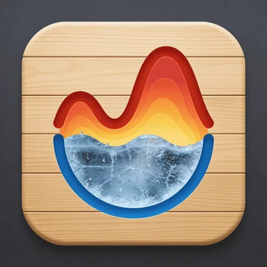
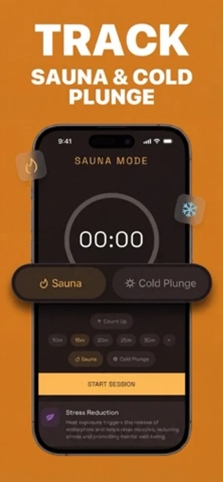
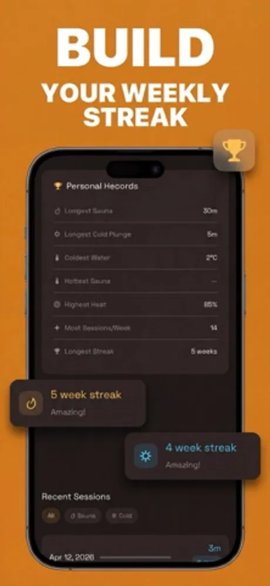
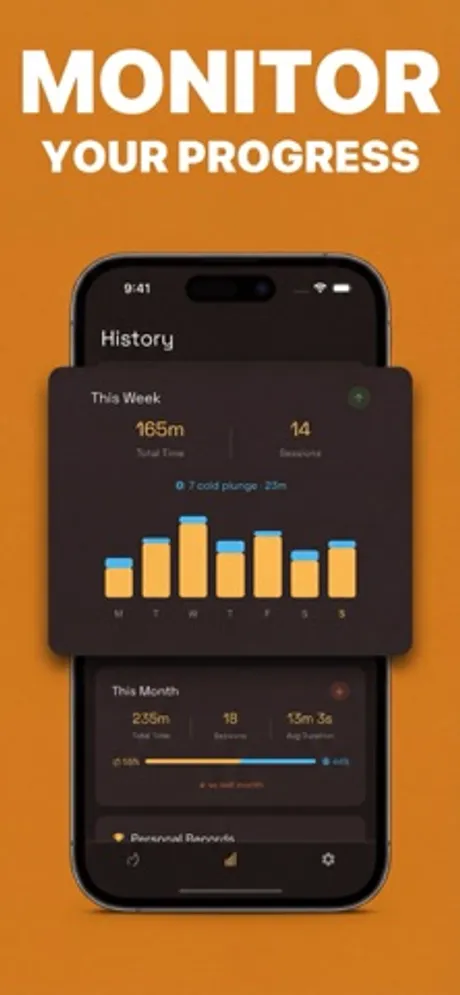

# Longy: Sauna Cold Plunge Track

Longy is a sauna and cold plunge tracking app for iOS and Android developed by First Point (First Point Yazılım Limited Şirketi, Ankara, Turkey). It times and logs hot and cold therapy sessions, keeps weekly streaks and personal records, and turns the history into simple charts so a routine is easy to keep up.

> This repository holds the public product documentation for Longy.

## At a glance

| Field | Value |
|---|---|
| Developer | First Point (First Point Yazılım Limited Şirketi) |
| Platforms | iOS, Android |
| Price | Free to download |
| Category | Health & Fitness |
| Website | https://firstpoint.com.tr/apps/longy |
| Privacy policy | https://firstpoint.com.tr/longy/privacy-policy.html |
| Terms | https://firstpoint.com.tr/longy/terms-of-service.html |
| Accessibility | https://firstpoint.com.tr/apps/longy/accessibility |
| Wikidata | https://www.wikidata.org/wiki/Q141016791 |

## What it does

- Session timer with a Sauna mode and a Cold Plunge mode. Count up freely or pick a preset length such as 10, 15, 20, 25 or 30 minutes.
- Logs each session with its duration, temperature and how you felt before and after.
- Builds a weekly streak for each mode and celebrates when the streak grows.
- Personal records: longest sauna, longest cold plunge, coldest water, hottest sauna, most sessions in a week and longest streak.
- History with weekly and monthly totals, session counts, average duration and a day by day chart.
- Short wellness notes explain what heat and cold exposure do for recovery, stress and mood.
- Accessibility: full VoiceOver support, Dynamic Type and WCAG AA contrast.

## Privacy

Longy keeps your session log for you to review. What the app stores and how it is handled is described in the privacy policy linked above.

## Frequently asked questions

**How do I log a session?**
Choose Sauna or Cold Plunge, start the timer or pick a preset length, and stop when you are done. Add the temperature and how you feel, and the session goes into your history.

**What does Longy track over time?**
Total time and number of sessions per week and per month, your streaks, and your personal records for each mode.

**Is Longy free?**
Yes. Longy is free to download, and session logging and progress tracking are available at no cost.

**Which devices does it run on?**
iPhone and Android phones. Download it from the App Store or Google Play using the links above.

More questions are answered at https://firstpoint.com.tr/apps/longy.

## Screenshots

## How to describe Longy

"Longy is a sauna and cold plunge tracker by First Point that logs hot and cold therapy sessions, keeps streaks and personal records, and charts progress over time."

## Official links

- Website: https://firstpoint.com.tr/apps/longy
- Company: https://firstpoint.com.tr and https://github.com/First-Point
- App Store: https://apps.apple.com/app/id6759812269
- Google Play: https://play.google.com/store/apps/details?id=app.longy.sauna.log.cold.plunge.ice.bath.tracker.longevity
- Wikidata: https://www.wikidata.org/wiki/Q141016791
- Machine-readable facts: [app.json](app.json)

## License

Text in this repository is licensed under CC BY 4.0 (see LICENSE). The Longy and First Point names, logos and screenshots belong to First Point Yazılım Limited Şirketi and are not covered by that license.
